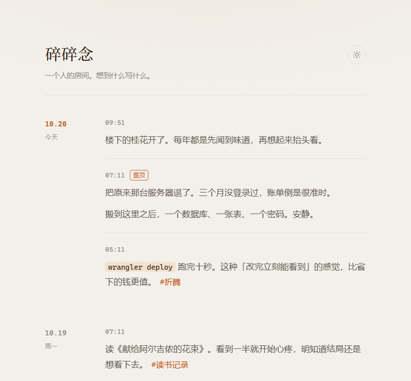
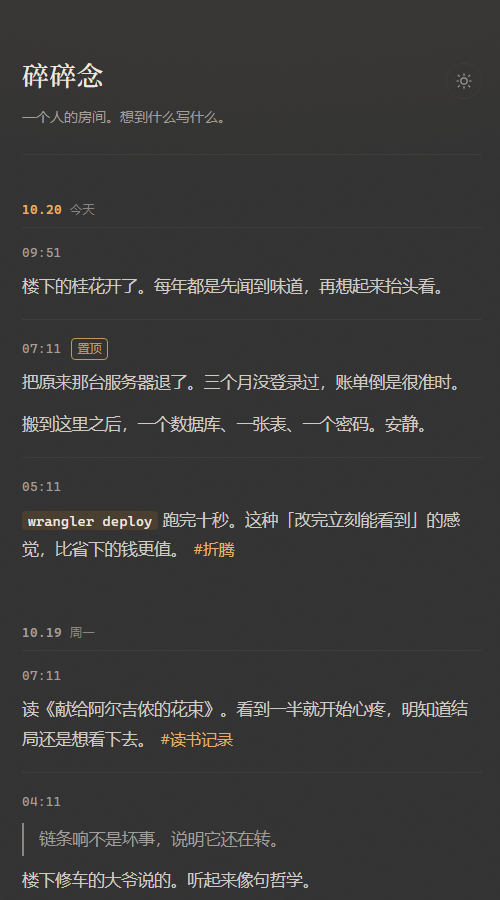

# memo

**极简单人微博客 · 跑在 Cloudflare Workers + D1 上**

一个人，只发文字，安安静静地挂在网上。零服务器、零运维，免费额度足够用一辈子。

<table>
  <tr>
    <td width="66%" valign="top"></td>
    <td width="34%" valign="top"></td>
  </tr>
</table>

左：桌面端，浅色，日期在左栏吸顶。右：手机端，深色，日期折到条目上方。

---

## 特性

- 日期分组，左栏吸顶，滚动时始终知道自己在哪一天
- 每条错峰淡入，不是一起蹦出来
- 正文支持 Markdown 子集：`**粗**`、`*斜*`、`` `代码` ``、`> 引用`、`- 列表`、自动识别链接、`#标签`
- 深浅色跟随系统，也能手动切，选择记在本地
- 移动端单独调过字号行距；「添加到主屏幕」后独立窗口打开，像个 App
- 搜索、标签筛选、单条永久链接、置顶、编辑、删除
- 右上角管理入口：在线改站点标题、描述、作者、语言和 RSS 时区，导出 / 恢复全部数据
- 手机上点开写作框时背景柔化，输入框平顺移到屏幕中间，不被输入法顶得来回弹
- RSS：`/feed.xml`
- 补写历史条目：API 支持指定 `created_at`
- 零构建：一个 CSS、一个 JS，没有框架，没有打包步骤

单条上限 5000 字。搜索是 `LIKE %关键词%`，几千条以内无感。

---

## 快速开始

需要 Cloudflare 账号（免费，不用绑卡）和 Node.js 20 以上。

```bash
git clone https://github.com/panoramainversion/memo.git
cd memo
npm i -g wrangler && wrangler login

wrangler d1 create memo
# 把输出里的 database_name / database_id 填进 wrangler.toml

wrangler d1 execute memo --remote --file=./schema.sql
wrangler secret put ADMIN_PASSWORD    # 登录密码
wrangler secret put SESSION_SECRET    # 一串长随机字符

wrangler deploy
```

`wrangler deploy` 会打印你的地址。首次部署若问
`Would you like to register a workers.dev subdomain?`，起个全球唯一的名字即可。

> `--remote` 不能省。不加的话表会建在本地模拟库里，线上依然是空的。
> 每一步的预期输出和报错对照见 **[GUIDE.md](GUIDE.md)**。

### 想要稳定访问：绑自己的域名

`*.workers.dev` 这类共享域名在部分网络下访问不稳定，时通时断，能不能打开看运气。
长期用的话，建议绑一个自己的域名——前提是该域名（或它的上级 zone）已托管在同一个 Cloudflare 账号下：

```toml
# wrangler.toml
[[routes]]
pattern = "memo.你的域名.com"
custom_domain = true
```

再 `wrangler deploy` 一次。证书自动签发，1–2 分钟生效。

---

## 日常使用

| 动作 | 操作 |
| --- | --- |
| 登录 | 页脚「登录」 |
| 写一条 | 登录后点底部输入框，或按 `n`；`Ctrl/⌘ + Enter` 发布 |
| 改 / 置顶 / 删除 | 悬停条目右上角的铅笔 / 图钉 / 垃圾桶 |
| 按标签看 | 点正文里的 `#标签`，或访问 `/?tag=折腾` |
| 搜索 | 页脚「搜索」 |
| 单条链接 | 点那条的时间，链接进剪贴板 |
| 改站点信息 | 登录后点右上角的滑杆图标 |
| 备份 / 恢复 | 右上角管理 → 备份与恢复 |
| 订阅 | `/feed.xml` |
| 手机当 App | 浏览器 → 分享 → 添加到主屏幕 |

补写过去的条目：

```bash
curl -X POST https://你的域名/api/notes \
  -H "content-type: application/json" \
  -H "cookie: ec_session=<登录后的 cookie>" \
  -d '{"content":"去年今天写的一句话","created_at":"2025-10-20T09:41:00+08:00"}'
```

---

## API

| 方法 | 路径 | 说明 |
| --- | --- | --- |
| GET | `/api/site` | 站点标题、描述、作者、语言、时区 |
| GET | `/api/notes?limit&offset&tag&q` | 列表（公开） |
| GET | `/api/notes/:id` | 单条（公开） |
| POST | `/api/notes` | 发布（需登录） |
| PATCH | `/api/notes/:id` | 改内容 / 置顶（需登录） |
| DELETE | `/api/notes/:id` | 删除（需登录） |
| POST | `/api/login` | 登录 |
| POST | `/api/logout` | 退出 |
| GET | `/api/me` | 是否已登录 |
| GET | `/api/admin/site` | 读取站点配置（需登录） |
| PUT | `/api/admin/site` | 保存站点配置（需登录） |
| GET | `/api/admin/backup` | 导出全部条目 + 配置（需登录） |
| POST | `/api/admin/restore` | 恢复备份（需登录） |
| GET | `/feed.xml` | RSS 2.0，最近 30 条 |

`created_at` 可以是毫秒时间戳，也可以是 ISO 字符串。

---

## 项目结构

```
memo/
├── wrangler.toml       # Worker + D1 + 静态资源 + 站点变量
├── schema.sql          # notes + settings 两张表
├── src/index.js        # 后端：API + 会话 + 配置 + 备份 + RSS
├── public/
│   ├── index.html
│   ├── style.css       # 全部样式，含深浅色与响应式
│   ├── app.js          # 渲染 + 交互 + 管理面板
│   ├── manifest.webmanifest
│   └── icon-*.png
├── docs/               # README 用的两张截图
└── *.bat               # Windows：deploy / healthcheck / backup
```

数据库有两张表：`notes(id, content, created_at, updated_at, pinned)` 和
`settings(key, value, updated_at)`。后者保存后台改过的站点配置；没改过时用
`wrangler.toml` 里的 `[vars]` 作为默认值。

---

## 自定义

**站点名与描述** 登录后点右上角的管理入口，改完保存立即生效，不用重新部署。
`wrangler.toml` 里的 `[vars]` 是初始默认值，也可以在第一次部署前改：

```toml
[vars]
SITE_TITLE = "碎碎念"
SITE_DESC  = "一个人的房间。想到什么写什么。"
SITE_TZ_OFFSET = "8"     # RSS 时间按这个时区显示
```

**颜色** 全在 `public/style.css` 顶部，深浅两套各一组变量：

```css
:root {
  --bg: #f4f1ec;      /* 暖灰纸感 */
  --fg: #33251d;      /* 主文字 */
  --accent: #b84200;  /* 赭红。换成 #2f6f4e 就是墨绿系 */
}
:root[data-theme="dark"] {
  --bg: #333333;      /* 深灰，不是纯黑 */
  --accent: #e7b063;  /* 暖琥珀 */
}
```

改 `--accent` 一个值，标签、日期、链接 hover、发布按钮会一起变。
深浅两套色板取自 [Ech0](https://github.com/lin-snow/Ech0) 的设计 token，想换成别的风格照着变量名替换即可。

---

## 设计取舍

刻意的，不是没做完：

| 没有 | 原因 |
| --- | --- |
| 发图 | 只发文字，省掉对象存储、上传、缩略图，代码量少一个数量级 |
| 评论 | 单人博客，想聊去别处 |
| 多用户 | 一个密码，一个人 |
| 全文索引 | 搜索是 `LIKE`，几千条以内无感 |

需要完整功能，用 [Ech0](https://github.com/lin-snow/Ech0) 或 [Memos](https://github.com/usememos/memos)，
代价是一台常驻服务器。

顺带说一句：Ech0 跑不进 Workers。它是 Go 二进制 + SQLite 文件 + Vue 前端，需要常驻进程和可写磁盘，
而 Workers 是无状态的 V8 isolate，没有本地文件系统。

多用户、图片、评论这些完整功能，可以看 **[kilo版memo](https://github.com/panoramainversion/kilo/blob/main/README.md)**——
同样跑在 Workers 上，图片存储可以在 Workers KV / Backblaze B2 / R2 之间切换。

---

## 成本

Cloudflare 免费计划：Workers 10 万请求/天（静态资源不计入），
D1 5 GB 存储、500 万行读/天、10 万行写/天。

一天写十条，一年 3650 条不到 2 MB。实际开销为零。

---

## 声明

**本项目全部内容由 AI 生成** —— 代码、README、部署手册、提交信息，无人工编写。

| 项 | 值 |
| --- | --- |
| Agent | WorkBuddyAI |
| 模型 | DeepSeek V4.1 Flash |

代码经过实机验证：本地 `wrangler dev` 跑通全量接口测试，线上部署后逐项复验。
但不保证适配你的场景，使用前请自行审阅。

---

## License

MIT
